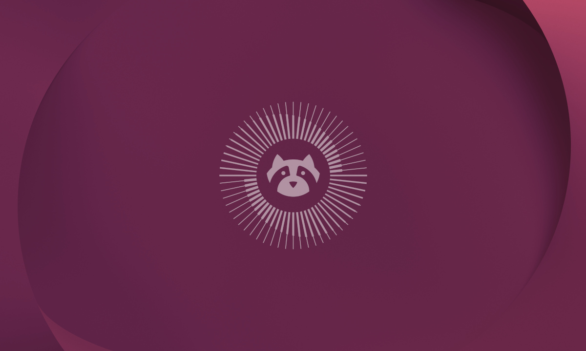

  

 

  

  

    
    
    
    
  

 

  

 

## 🧑‍💻 About Me

<table width="100%">
  <tr>
    <td valign="top" width="78%">
      <ul>
        <li>🎓 <b>Software Analysis &amp; Development Technologist (ADSO)</b> — <b>SENA</b>, <b>6th semester</b>.</li>
        <li>💻 <b>Full Stack Developer</b> with a solid foundation in business logic, interface design and software architecture.</li>
        <li>🌱 Currently deepening <b>Docker &amp; Kubernetes</b>, <b>robust APIs</b> and <b>AI applied to development</b>.</li>
        <li>🗄️ Passionate about <b>relational database modeling and optimization</b>.</li>
        <li>📍 <b>Medellín, Antioquia — Colombia</b> · 🚀 Open to <b>internships and job opportunities</b>.</li>
      </ul>
      
<i>💡 "Software is a great blend of art and engineering."</i>

    </td>
    <td valign="middle" align="center" width="22%">
      
    </td>
  </tr>
</table>

 

## 🛠️ $ cat tech-stack.yaml

  

 

## 📦 Featured Projects

  

    &nbsp;
  

  

    &nbsp;
  

 

## 🛰️ $ kubectl get signals --all-namespaces

  
<code>signals: fullstack_skill_radar · language_stack_radar · status: healthy</code>

  
  

    

  

    

  

    

  

 

## 🎮 Pac-Man eats my contributions

  

 

## 🐍 $ tail -f contributions.log

  

 

## 📡 $ connect --socials

  
  
  

  

    
  

  
<em>Got a project or an opportunity? Let's talk! 🚀</em>

 

  

