  

 

  

  

    
    
    
    
  

 

  

 

## 🧑‍💻 Sobre mí

- 🎓 **Tecnólogo en Análisis y Desarrollo de Software (ADSO)** — **SENA**, **sexto trimestre** de la etapa lectiva.
- 💻 **Full Stack Developer** con base sólida en lógica de negocio, diseño de interfaces y arquitectura de software.
- 🌱 Profundizando en **Docker & Kubernetes**, **APIs robustas** e **Inteligencia Artificial aplicada al desarrollo**.
- 🗄️ Apasionado del **modelado y optimización de bases de datos relacionales**.
- 📍 **Medellín, Antioquia — Colombia** · 🚀 Abierto a **prácticas profesionales y oportunidades laborales**.

> 💡 *"El software es una gran combinación entre arte e ingeniería."*

 

## 🛠️ Stack Tecnológico

<table width="100%">
  <tr>
    <td width="50%" valign="top">
      <h4>🎨 Frontend &amp; Backend</h4>
      

        
      

      Interfaces responsive con React y Tailwind; servicios y APIs con Java, Node.js y Python (Django / FastAPI).
    </td>
    <td width="50%" valign="top">
      <h4>🗄️ Datos, DevOps &amp; Herramientas</h4>
      

        
      

      Modelado relacional, contenedores y orquestación; control de versiones y documentación de APIs con Postman.
    </td>
  </tr>
</table>

 

## 📦 Proyectos Destacados

  

    &nbsp;
  

  

    &nbsp;
  

 

## 📈 Estadísticas de GitHub

  
  

    

  

    

  

    

  

 

## 🦝 Pac-Mapache recoge mis contribuciones

  

 

## 📬 Conecta Conmigo

  
  
  

  
<em>¿Tienes un proyecto o una oportunidad? ¡Hablemos! 🚀</em>

 

  

